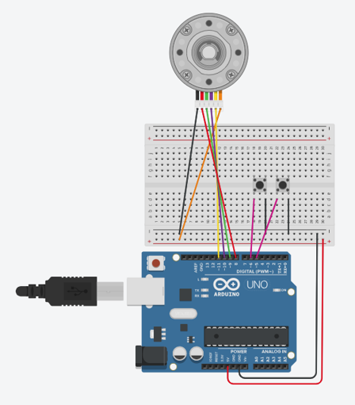
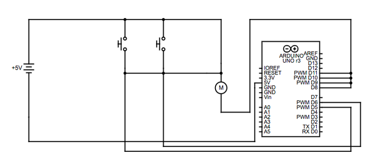

# Stepper Motor Controller

Two-button stepper motor direction controller for Arduino (ATmega328).  

Built as part of my 2019 GCSE Design & Technology project.

**_Uploaded by request from the comments on [this video](https://www.youtube.com/shorts/_QWHReOaG14)._**

## Hardware

- **Board:** Orangepip Kona328 (ATmega328-based, Arduino Uno compatible)
- **Motor:** 28BYJ-48 stepper motor (or equivalent, 2038 steps/revolution)
- **Buttons:** x2 push-to-make (/normally open) buttons
- **Driver**: ULN2003 stepper motor driver board
- _**Breadboard**: if prototyping before using Arduino only_

## Wiring

_**Important:** Do not connect the stepper motor directly to the Arduino pins. The driver board must be used to prevent damaging the Arduino._

| Component | Pin |
|-----------|-----|
| ULN2003 IN1 (for stepper coil A) | D8 |
| ULN2003 IN2 (for stepper coil B) | D9 |
| ULN2003 IN3 (for stepper coil C) | D10 |
| ULN2003 IN4 (for stepper coil D) | D11 |
| ULN2003 - (GND) | GND |
| ULN2003 + (5V) | 5V |
| Button 1 (CW) | D5 |
| Button 2 (ACW) | D6 |

- **Motor Connection:** The stepper motor's 5-pin wire bundle plugs directly into the plastic socket on the ULN2003 driver board.
- **Button Connection:** Buttons are wired with `INPUT_PULLUP` - connect one leg to the Arduino pin, and the other leg to GND.

_**Please note:** The driver board is **not** shown in the basic setup schematics below, but must be used._

## Prototyping With Breadboard

## Circuit Schematic

## Dependencies

- Built-in Arduino Stepper library (no install needed)

## Usage

1. Open `stepper_control/stepper_control.ino` in Arduino IDE
2. Select board: Arduino Uno (Kona328 is Uno-compatible)
3. Upload and press either button to rotate clockwise/anticlockwise
